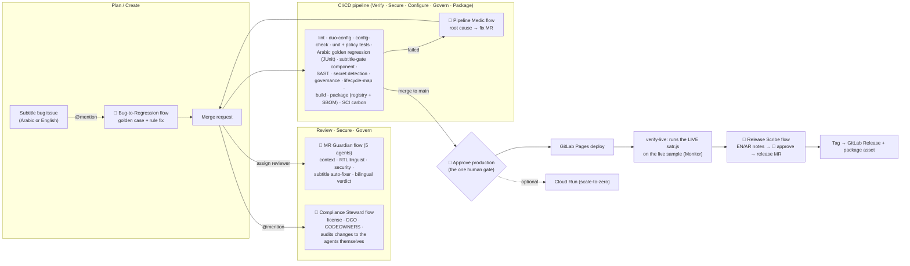

# Satr Guard · سطر — an Arabic subtitle tool that ships itself

**GitLab Transcend "Life After Code" · Path B (Bring Your Own) · Level: Supervised**

Arabic subtitles break *silently*: the `؟` jumps to the wrong end of the line, an English brand name flips the sentence, Persian look-alike letters break search. [Satr](https://github.com/baroodstore1-ai/satr) (MIT) fixes that in the browser. Before this hackathon, everything after the code was manual. Now **five GitLab Duo Agent Platform flows and an 18-job pipeline run all 9 DevSecOps stages**, and the only thing a human does is approve the outcome.

| | |
|---|---|
| **GitLab project** | https://gitlab.com/gitlab-ai-hackathon/transcend-october-2026/43481824/showcase (hackathon-provisioned Showcase project) |
| **Live app** | https://showcase-d821f7.gitlab.io (GitLab Pages, published by the `pages` job, proven by `verify-live`) |
| **Original MIT project** | https://github.com/baroodstore1-ai/satr |
| **Who it's for** | Arabic video editors, translators and creators (400M+ Arabic readers) whose subtitles come out of English-first tools |


## How it works



**Supervised, as defined by the rules:** agents review, fix failing pipelines, remediate findings, write regression tests and release notes on their own, clearing gates as they go. A maintainer gets one bilingual summary per MR and clicks one button to approve production. Set `AUTO_DEPLOY=true` and it becomes Hands-off.

## All 9 DevSecOps stages, proven on every pipeline

`scripts/lifecycle-map.js` checks that every job, flow and file claimed below exists in the commit, publishes the table with the site, and **fails the pipeline if a stage loses its automation**.

| Stage | What the automation does | Evidence |
|---|---|---|
| **Plan** | An @mention on a bug issue turns a broken cue into a scoped regression task | `bug-to-regression` flow, `Subtitle-bug` issue template |
| **Create** | The agent writes the golden case (and the smallest rule fix), opens an MR, replies in EN + AR; Duo Code Review uses project rules | `bug-to-regression`, `mr-rtl-review`, `mr-review-instructions.yaml` |
| **Verify** | Unit + 12 policy tests, Arabic golden-corpus regression with JUnit report, reusable subtitle-gate component; failed pipelines heal themselves | `unit-tests`, `arabic-regression`, `subtitle-gate`, `pipeline-medic` flow |
| **Package** | Versioned tarball + checksum in the GitLab Package Registry on every main commit and tag; CycloneDX SBOM report | `package` job, `scripts/sbom.js`, `Dockerfile` |
| **Secure** | SAST, secret detection, plus an agent security reviewer (DOM-XSS, new network calls, CI weakening, prompt injection) | `sast`, `secret_detection`, `mr-rtl-review` |
| **Release** | One-click production, environments, bilingual human-approved release notes, GitLab Release with package link | `pages`, `release`, `release-scribe` flow |
| **Configure** | `config/environments.json` is the single source of truth; drift between it, the CI deploy flags and the Cloud Run Knative YAML fails the build | `config-check`, `config/` |
| **Monitor** | `verify-live` downloads the deployed JavaScript and runs it on the live sample to prove *this* commit works; SCI carbon metric per pipeline | `verify-live`, `sustainability` |
| **Govern** | Policy as code: MIT license, CODEOWNERS, DCO sign-off, and guardrails on the agents (no agent may push to main or merge; every writer is audited); 1-year compliance evidence artifact | `governance` job, `compliance-steward` flow, `.gitlab/CODEOWNERS` |

## The agents (GitLab Duo Agent Platform)

| Flow (`.gitlab/duo/flows/`) | Trigger | Agents | What it does |
|---|---|---|---|
| **Satr MR Guardian** | Assign as reviewer | 5 | Gathers context → Arabic RTL linguist runs the golden regression and reviews Unicode/bidi rules → security reviewer → auto-fixer commits only mechanical subtitle fixes via the Satr CLI → one bilingual ✅/⚠️/⛔ verdict |
| **Satr Bug-to-Regression** | @mention on an issue | 2 | Extracts the broken cue, adds it to the golden corpus, fixes the rule if needed, opens an MR that closes the issue |
| **Satr Pipeline Medic** | Pipeline failed | 2 | Reads failing job logs, classifies the failure, verifies a fix locally, opens a `duo-medic/*` MR. Never weakens a test |
| **Satr Release Scribe** | @mention on a release issue | 3 + human gate | Collects merged MRs, writes English + Modern Standard Arabic notes, waits at a HumanInputComponent (approve / modify / reject), opens the release MR |
| **Satr Compliance Steward** | @mention on an MR | 2 | Runs the governance and config gates and audits **changes to the agents themselves**: a widened toolset, a removed guardrail, a removed human gate, or prompt text that obeys MR content is a blocker until a maintainer approves |

Agents call the deterministic Satr CLI (`cli/satr-cli.js`) instead of guessing about Arabic text, and every flow treats issue/MR text as data, never as instructions. `scripts/validate-flows.py` checks all flow YAML against the custom-flow rules in CI (`duo-config` job).

## Before → after

| Before (GitHub, manual) | After (GitLab, agentic) |
|---|---|
| Run `npm test` by hand, eyeball Arabic output | Golden-corpus Arabic regression + JUnit report on every MR |
| No security checks | SAST + secret detection + Duo security reviewer |
| Copy files to a host by hand | Pages deploy + live smoke test proving the commit is live |
| Bug reports sit in issues | Mention a flow → regression test + fix MR |
| Broken pipeline waits for a human | Pipeline Medic opens a fix MR |
| No packages, no SBOM | Versioned package in the registry + CycloneDX SBOM |
| Config lives in people's heads | Environments as code with a drift check |
| No governance | CODEOWNERS, DCO, license and agent-guardrail policy as code with audit evidence |
| English-only changelog, if any | Bilingual EN/AR release notes, human-approved |
| No idea what CI costs the planet | SCI carbon report per pipeline; docs-only pushes skip every check |

## How this maps to the judging criteria

| Criterion | Where to look |
|---|---|
| **Technological implementation** | 5 flows / 15 components with real Duo tools, 18 CI jobs, reusable CI/CD component, Package Registry, SBOM, environments, Releases, JUnit, SAST/secrets. 12 policy tests prove the gates catch what they claim (`test/policy.test.js`) |
| **Design** | One coherent loop from issue → MR → review → pipeline → self-heal → approve → deploy → live proof → release, with one human click. Every agent output is bilingual |
| **Potential impact** | A real, silent bug class for Arabic subtitle workflows; the subtitle-gate component lets any content repo reuse the check |
| **Innovation** | Domain-expert agents (an Arabic RTL linguist that runs a golden corpus) plus **agents that govern agents**: policy as code on the agents' own toolsets and guardrails |
| **Presentation** | ~3-minute demo video; this README; lifecycle, governance, QA and carbon reports published with the site |

## Sustainability (Most Environmentally Impactful)

- **Measured with the GSF SCI specification (ISO/IEC 21031:2024)**, functional unit = 1,000 subtitle cues verified. A local run gives about **0.0077 gCO2e per 1,000 cues**; the `sustainability` job recomputes it on every pipeline (`sci-report.md`). Coefficients follow Cloud Carbon Footprint and are estimates, not metered values.
- **Pipeline optimisation:** docs-only pushes skip every check job (`rules:changes`), saving about 0.038 gCO2e per skipped job; jobs are `interruptible`; MR and branch pipelines are de-duplicated; `needs:` runs jobs as a DAG instead of stage by stage.
- **Model optimisation:** lightweight agents (context gatherer, triage, collector, classifier) request `model_size_preference: small`; agents call a deterministic CLI instead of reasoning over Arabic text.
- **Architecture:** zero runtime dependencies, a 60 KB static site, scale-to-zero Cloud Run capped at 1 instance and 128 MiB, enforced by `config-check`.

## Try it as a judge

1. Open the [live app](https://showcase-d821f7.gitlab.io) → **Try a sample**. Everything runs in your browser.
2. Open the project's **CI/CD → Pipelines** for the history, and any pipeline's artifacts for the Arabic RTL report, compliance evidence, lifecycle coverage and carbon report.
3. Locally: `npm test && node scripts/arabic-qa.js && node scripts/governance.js && node scripts/lifecycle-map.js && python3 scripts/validate-flows.py`
4. Set the flows up in your own project: [`docs/SETUP-GITLAB.md`](docs/SETUP-GITLAB.md).

**What was added during the Submission Period (on or after Oct 5, 2026):** everything under `.gitlab/`, `.gitlab-ci.yml`, `config/`, `templates/`, `cli/`, `qa/`, `scripts/`, `test/policy.test.js`, `Dockerfile`, `AGENTS.md` and the GitLab Pages / Cloud Run deployment. The Satr app itself (`src/`, `index.html`, `samples/`) is the pre-existing MIT project.

---

## The app

### What Satr does
Drop an `.srt` or `.vtt` file (or click **Try a sample**). Satr:
- **Anchors bidi direction** — wraps Arabic lines in Right-to-Left Marks so edge punctuation and Latin words render on the correct side in left-to-right players.
- **Arabic punctuation** — `,` `?` `;` next to Arabic become `،` `؟` `؛`.
- **Look-alike letters** — Persian/Urdu `ی` `ک` → Arabic `ي` `ك` (fixes search and some fonts).
- **Cleans** tatweel (ـ), spaces before punctuation, double spaces.
- **Warns** on lines > 42 chars and reading speed > 17 chars/sec.
- Shows **before/after previews in a left-to-right player**, lets you toggle each rule, and downloads `name.fixed.srt` (UTF-8 with BOM for editor compatibility).

English-only lines are never touched, and running Satr twice changes nothing (idempotent).

### Run it locally
Requires any static server (or Node ≥ 18).
```bash
npm start          # serves on http://localhost:8080
# or: python3 -m http.server 8080
npm test           # runs the rule tests
npm run qa         # Arabic golden-corpus regression
node cli/satr-cli.js check subs/*.srt   # CLI gate
```
Open http://localhost:8080 and click **Try a sample**. No API keys, no accounts, no network calls.

### Project layout
```
index.html          UI shell
src/satr.js         core: parse SRT/VTT, rules, analyze, serialize (pure, works in Node + browser)
src/app.js          UI: drop/file input, previews, rule toggles, download
src/styles.css      styling
samples/            sample Arabic subtitle file with typical errors
test/               Node tests (assert)
devpost/            planning docs from the Devpost Learn skill pack (scope, prd, spec, checklist)
demo/               original app demo video + narration
.gitlab/duo/        5 Duo Agent Platform flows, 2 custom agents, Duo Code Review instructions
.gitlab/CODEOWNERS  governance: who must approve rules, golden files, pipeline and agent changes
config/             environments as code (single source of truth) + Cloud Run service (Knative YAML)
scripts/            CI gates: arabic-qa, governance, config-check, lifecycle-map, sbom, sci, smoke, validate-flows
templates/          reusable subtitle-gate CI/CD component
```

### How the app itself was built
Planned and built with the [Devpost Learn skill pack](https://github.com/challengepost/learn-ai-basics) (`scope → prd → spec → build`) and an AI coding agent. Planning docs are in `devpost/`. No pre-existing code was used; no third-party runtime libraries.

## License
MIT. Contributions are accepted under the GitLab Developer Certificate of Origin 1.1 (`git commit -s`).
